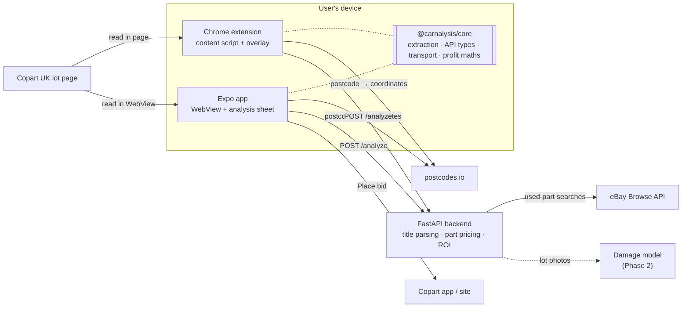

# Carnalysis

[](https://github.com/H-Ali1/carnalysis/actions/workflows/ci.yml)
[](LICENSE)


**Profit estimates for Copart UK salvage auctions — on the lot page, before you bid.**

Salvage auctions sell damaged cars cheaply, but whether a lot is worth bidding on comes down
to sums buyers usually do by hand: the buyer's fee, the cost of replacement parts, transport
from the yard, and what the car is worth once repaired. Carnalysis reads a Copart lot page,
prices the damaged panels against live used-part listings on eBay, and returns an itemised
profit and ROI estimate — plus the highest bid that still hits a target profit.

It runs as a **Chrome extension** on desktop and an **Expo (React Native) app** on phones,
both backed by a **FastAPI** service.

## Features

- **One-tap extraction** of the lot's title, current bid, Copart's retail-value estimate,
  damage, yard, odometer and photos
- **Live part pricing** — the median of the top used, UK-located eBay listings for each damaged
  panel, for that make, model and year
- **Transport quote** by road distance from your postcode to the lot's yard
- **Itemised breakdown** of hammer price, buyer's fee, parts, transport, profit and ROI
- **Max-bid calculator** for £500 and £1k profit targets
- **Bid handoff** on mobile: one tap opens the lot in the Copart app or site

## How it works



1. **Extract.** The client reads the lot page the user already has open.
2. **Analyse.** The backend parses the vehicle from the lot title, prices each damaged panel
   that needs a replacement part, and computes the breakdown:

   ```text
   profit = ARV − (hammer price + buyer's fee + parts + transport)
   ROI    = profit ÷ total cost
   ```

3. **Decide.** The client shows the breakdown, the max bid for each profit target and — on
   mobile — a button that opens the lot in Copart to bid.

## Design decisions

- **The page is read on the user's device, never scraped server-side.** Copart sits behind
  Imperva bot management. Both clients read the page the user already has open — a content
  script on desktop, a script injected into the app's WebView on mobile — so the backend never
  contacts Copart at all.
- **Fields are found by label, not CSS class.** Copart's class names are build-hashed and change
  between deploys. Each field is located by its visible label ("Odometer", "Primary damage")
  using three fallback strategies, each covered by fixture tests.
- **One extractor, two runtimes.** Scripts injected into a WebView can't import modules, so the
  mobile script is *generated* from the same TypeScript the extension runs (esbuild → string
  constant). A parity test runs both against one fixture page, and CI fails if the generated
  file is stale.
- **The vehicle comes from the title alone.** Guests can't see a lot's VIN or registration, but
  the title (`2017 VOLKSWAGEN POLO 1.0 75 MATCH EDITION 5DR`) gives the year, make and model —
  everything the part search needs — so no paid vehicle-data API is required.
- **Degrade loudly, never guess.** If a part can't be priced, the response says so
  (`parts_cost: null` and a warning) instead of silently counting it as £0.
- **Bidding stays on Copart.** The app never automates bids; it hands the user off to Copart.

## Tech stack

| Area | Tools |
| --- | --- |
| Backend | Python 3.11+, FastAPI, Pydantic v2, httpx · pytest, Ruff, mypy (strict) |
| Shared client logic | TypeScript, Vitest, jsdom, esbuild |
| Chrome extension | React 18, Vite, CRXJS, Manifest V3 |
| Mobile app | Expo SDK 57, React Native 0.86, react-native-webview |
| Tooling | Biome, GitHub Actions |

## Repository layout

```text
backend/          FastAPI service: title parsing, eBay part pricing, ROI maths
  app/              application package (routes, analysis, pricing, models)
  tests/            pytest suite
packages/core/    TypeScript shared by both clients: API types, lot-page
                  extraction, transport quotes, profit maths
extension/        Chrome extension (content script + overlay)
mobile/           Expo app (in-app browser + analysis sheet)
docs/             original project specification
```

## Getting started

Requirements: Python 3.11+ and Node 24 (see [`.nvmrc`](.nvmrc)). Part pricing needs
[eBay developer keys](https://developer.ebay.com/my/keys); without them, estimates exclude
parts and say so.

### Backend

```bash
cd backend
python -m venv .venv
source .venv/bin/activate          # Windows: .venv\Scripts\activate
pip install -r requirements-dev.txt
cp .env.example .env               # add your eBay keys
uvicorn app.main:app --reload
```

Interactive API docs are served at <http://localhost:8000/docs>.

### Chrome extension

```bash
cd extension
npm install
npm run build
```

In `chrome://extensions`, enable **Developer mode**, choose **Load unpacked** and select
`extension/dist`. Open any Copart UK lot page and click **Calculate ROI**.

### Mobile app

```bash
cd mobile
npm install
cp .env.example .env               # EXPO_PUBLIC_BACKEND_URL=http://<your LAN IP>:8000
npx expo start                     # scan the QR code with Expo Go
```

Start the backend with `--host 0.0.0.0` so your phone can reach it.

## API

`POST /analyze` takes a lot's details and returns the breakdown:

```json
{
  "lot_title": "2017 VOLKSWAGEN POLO 1.0 75 MATCH EDITION 5DR",
  "damage_observations": [
    { "panel": "front_bumper", "damage_type": "crack" },
    { "panel": "bonnet", "damage_type": "dent" }
  ],
  "hammer_price": 1200,
  "arv": 4500,
  "transport": 95
}
```

```json
{
  "vehicle": { "make": "Volkswagen", "model": "Polo", "year": 2017 },
  "observations": [
    { "panel": "front_bumper", "damage_type": "crack", "part_required": true, "parts_cost": 85.0 },
    { "panel": "bonnet", "damage_type": "dent", "part_required": false, "parts_cost": 0.0 }
  ],
  "hammer_price": 1200.0,
  "copart_fee_rate": 0.12,
  "copart_fees": 144.0,
  "total_parts": 85.0,
  "transport": 95.0,
  "total_cost": 1524.0,
  "arv": 4500.0,
  "profit_estimate": 2976.0,
  "roi_percent": 195.3,
  "warnings": []
}
```

See [`backend/README.md`](backend/README.md) for configuration and error responses.

## Testing

CI runs every check below on each push and pull request.

| Package | Checks |
| --- | --- |
| `backend/` | `ruff check .` · `ruff format --check .` · `mypy` · `pytest` |
| `packages/core/` | `npm run typecheck` · `npm test` · generated-script freshness |
| `extension/` | `npm run build` (type-checks, then bundles) |
| `mobile/` | `npm run typecheck` · Metro bundle for Android and iOS |
| repository root | `npm run lint` (Biome lint + format for all TypeScript) |

## Roadmap

The backend, Chrome extension, mobile app and shared client package are working. Next up:
automatic damage detection from lot photos (a fine-tuned YOLO model), caching eBay prices, and
hosting the backend for app-store distribution. See [`ROADMAP.md`](ROADMAP.md) for the full
plan and the reasoning behind past decisions.

## Disclaimer

Carnalysis is an independent personal project. It is not affiliated with or endorsed by Copart.
It reads only pages the user opens themselves and never places bids. Estimates are indicative
and are not financial advice.

## License

[MIT](LICENSE) © 2026 Hashir Ali
