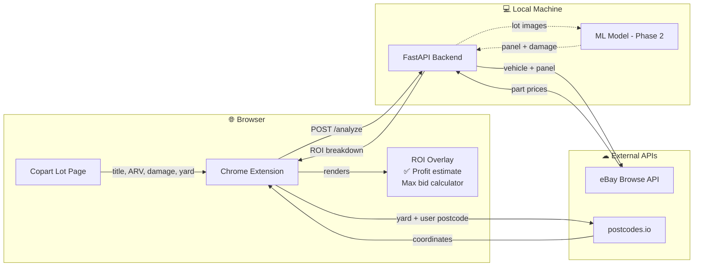

# Carnalysis

A Chrome extension + FastAPI backend that scrapes Copart UK auction lot pages and calculates the estimated ROI for each salvage vehicle — factoring in hammer price, Copart fees, eBay part costs, and transport.

## How it works



> Dashed lines indicate the ML damage detection path (Phase 2 — not yet active).

## Setup

**Backend:**
```bash
cd backend
pip install -r requirements.txt
cp .env.example .env   # add EBAY_CLIENT_ID and EBAY_CLIENT_SECRET
uvicorn main:app --reload
```

**Extension:**
```bash
cd extension
npm install
npm run build
```
Load `extension/dist` as an unpacked extension in `chrome://extensions`.

See `ROADMAP.md` for full phase-by-phase status.

---

## Chrome Web Store Limitation

**1. Copart's Terms of Service**
Copart's terms restrict automated scraping and data extraction from their platform. 
