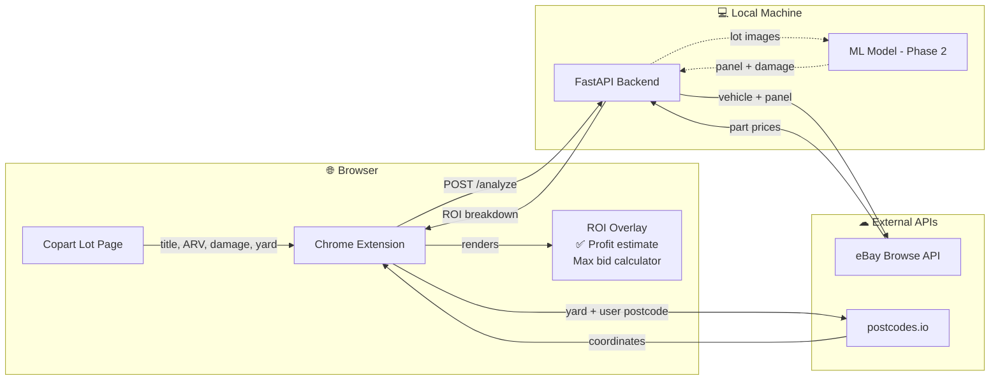

# Carnalysis

A Chrome extension + FastAPI backend that scrapes Copart UK auction lot pages and calculates the estimated ROI for each salvage vehicle — factoring in hammer price, Copart fees, eBay part costs, and transport.

## How it works



> Dashed lines indicate the ML damage detection path (Phase 2 — not yet active).

## Setup

**Backend:**
```bash
cd backend
pip install -r requirements.txt
cp .env.example .env   # add EBAY_CLIENT_ID and EBAY_CLIENT_SECRET
uvicorn main:app --reload
```

**Extension:**
```bash
cd extension
npm install
npm run build
```
Load `extension/dist` as an unpacked extension in `chrome://extensions`.

See `ROADMAP.md` for full phase-by-phase status.

---

## Why this can't be published to the Chrome Web Store

Publishing to the Chrome Web Store costs a one-time $5 registration fee, but the extension is deliberately kept as a local unpacked install for three reasons:

**1. The backend runs on your machine**
The extension calls `http://localhost:8001/analyze`. Any other user who installed it from the store would get a network error because they don't have the FastAPI backend running locally. Hosting the backend on a public server (e.g. a VPS) would be required before public distribution makes sense.

**2. eBay API credentials are personal**
The backend uses your personal eBay Developer credentials (`EBAY_CLIENT_ID` / `EBAY_CLIENT_SECRET`) stored in `backend/.env`. These are tied to your account and cannot be bundled into a public release. Each user would need to register their own eBay Developer app and supply their own keys.

**3. Copart's Terms of Service**
Copart's terms restrict automated scraping and data extraction from their platform. Distributing a tool that automates this on the Chrome Web Store would make the scraping activity visible and attributable, increasing legal exposure. Running it as a private, personal tool for your own use is a much lower-risk position.
